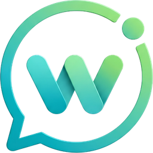

<div align="center">



# WABEK — WhatsApp Business Automation Platform

**Multi-tenant WhatsApp SaaS built on Next.js · Supabase · Meta Cloud API**

[](https://app.netlify.com/start)
[](./LICENSE)
[](https://webek.org)

[Live Demo](https://waabek.com) · [Status](https://waabek.com/status) · [Docs](https://waabek.com/docs)

</div>

---

## ✨ Features

| Category | Features |
|---|---|
| 💬 **Messaging** | Bulk campaigns, scheduled sends, personalization |
| 🤖 **AI Assistant** | DeepSeek-powered auto-reply with 24h window detection |
| 📥 **Team Inbox** | Shared inbox, assignment, labels, notes |
| 🔄 **Automation** | Chatbot builder, triggers, flows, sequences |
| 📊 **Analytics** | Delivery rates, read rates, campaign stats |
| 🔗 **Integrations** | Wix, WordPress, WHMCS, Webhooks |
| 💳 **Billing** | Stripe subscriptions, invoices, usage limits |
| 🎫 **Support** | Live ticket system with WhatsApp + email notifications |
| 🌍 **Multi-language** | Arabic, English, French, Turkish |
| 🏷️ **White Label** | Custom domain, logo, brand colors |

---

## 🚀 Quick Start

### Prerequisites

- Node.js 18+
- Supabase account
- Meta Developer account with WhatsApp Business API access
- Stripe account
- Netlify account
- DeepSeek API key (for AI features)

### 1. Clone & Install

```bash
git clone https://github.com/WEBEK-LTD/my-wabek.git
cd my-wabek/wabek
npm install
```

### 2. Environment Variables

Copy `.env.example` to `.env.local` and fill in:

```env
# Supabase
NEXT_PUBLIC_SUPABASE_URL=https://xxxxx.supabase.co
NEXT_PUBLIC_SUPABASE_ANON_KEY=eyJ...
SUPABASE_SERVICE_ROLE_KEY=eyJ...

# Meta WhatsApp Cloud API
WHATSAPP_WEBHOOK_VERIFY_TOKEN=your_verify_token

# Stripe
STRIPE_SECRET_KEY=sk_live_...
STRIPE_WEBHOOK_SECRET=whsec_...
NEXT_PUBLIC_STRIPE_PUBLISHABLE_KEY=pk_live_...

# AI
DEEPSEEK_API_KEY=sk-...

# Email
RESEND_API_KEY=re_...
ADMIN_EMAIL=support@yourdomain.com

# Baileys Server (optional)
WABEK_EVENTS_URL=https://your-baileys-server.railway.app
WABEK_EVENTS_SECRET=your_secret
```

### 3. Database Setup

Run migrations in order in Supabase SQL Editor:

```bash
supabase/migrations/001_initial.sql
supabase/migrations/002_wa_web_support.sql
...through...
supabase/migrations/015_fix_duplicates.sql
```

### 4. Deploy to Netlify

```bash
# Install Netlify CLI
npm install -g netlify-cli

# Deploy
netlify deploy --prod
```

Or connect your GitHub repo to Netlify for automatic deployments.

---

## 🏗️ Architecture

```
my-wabek/
├── wabek/                    # Main Next.js app
│   ├── pages/
│   │   ├── api/              # API routes
│   │   │   ├── whatsapp/     # WhatsApp webhooks & send
│   │   │   ├── admin/        # Admin APIs
│   │   │   ├── support/      # Support ticket APIs
│   │   │   ├── billing/      # Stripe billing
│   │   │   └── ai/           # AI assistant
│   │   ├── dashboard/        # User dashboard pages
│   │   ├── admin/            # Admin panel pages
│   │   └── legal/            # Legal pages
│   ├── components/           # React components
│   ├── lib/                  # Core libraries
│   │   ├── whatsapp.ts       # Meta Cloud API client
│   │   ├── wa-smart-send.ts  # 24h window + template fallback
│   │   ├── ai-engine.ts      # AI auto-reply engine
│   │   └── supabase.ts       # Database client
│   └── supabase/migrations/  # Database migrations
├── wabek-baileys/            # Baileys WhatsApp Web server
└── wabek-whmcs/              # WHMCS plugin
```

---

## 📱 WhatsApp Connection Methods

| Method | Best For | Setup |
|---|---|---|
| **Meta Cloud API** | Production, high volume | Meta Developer Portal |
| **Baileys (WA Web)** | Testing, small scale | Deploy `wabek-baileys/` to Railway |

---

## 🤖 AI Auto-Reply

WABEK uses **DeepSeek** for AI-powered auto-replies:

- Responds only when no chatbot flow matches
- Detects escalation keywords → routes to human agent
- **24-hour window detection** → automatically uses approved WhatsApp templates outside the window
- Configurable system prompt, temperature, max tokens per instance

**Approved Templates:**
- `support_ticket_update` — Support replies outside 24h
- `ai_assistant_followup` — AI initiates outside 24h
- `welcome_message_v2` — New customer onboarding
- `payment_reminder` — Billing reminders
- `marketing_offer` — Campaign messages
- `broadcast_notification` — Announcements
- And more — configurable in Admin → WA Templates

---

## 🎫 Support Ticket System

- Tickets numbered from #7254
- Email notifications on open & reply
- WhatsApp notifications (respects 24h window)
- AI assistant available outside business hours (9AM–6PM)
- Admin panel with customer details, chat history, status management

---

## 🔐 Security

- JWT authentication with bcrypt passwords
- Two-factor authentication (2FA)
- Row Level Security (RLS) on all Supabase tables
- CSRF protection
- Webhook signature verification

---

## 🌐 Supported Languages

🇸🇦 Arabic (RTL) · 🇺🇸 English · 🇫🇷 French · 🇹🇷 Turkish

---

## 📄 License

This software is **proprietary** and owned by **[webek.org](https://webek.org)**.

See [LICENSE](./LICENSE) for full terms.  
Unauthorized use, copying, or distribution is strictly prohibited.

---

<div align="center">

Built with ❤️ by **[webek.org](https://webek.org)**

[waabek.com](https://waabek.com) · support@waabek.com

</div>
